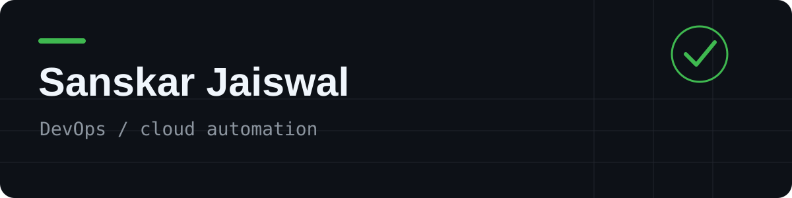

<picture>
  <source media="(prefers-color-scheme: dark)" srcset="assets/banner-dark.svg">
  <source media="(prefers-color-scheme: light)" srcset="assets/banner-light.svg">
  
</picture>

### Building reliable automation, one useful tool at a time

**Open to part-time DevOps and cloud automation conversations · India (IST, UTC+05:30)**

## About

I'm Sanskar Jaiswal. My public work currently centers on Python development checks and automation. I'm growing this portfolio toward cloud infrastructure, CI/CD, and operational tooling.

- **Current project:** [code_review_agent](https://github.com/SanskarJaiswal007/code_review_agent)
- **Working style:** documented setup, repeatable checks, and reviewable changes
- **Location:** India; open to remote, part-time project conversations

## Tools in my public work

| Area | Tools |
| --- | --- |
| Python quality | Python, Ruff, ty, pytest, pre-commit |
| Workflow | Git, GitHub, uv |

I'm exploring Terraform, containers, and cloud delivery. I'll add them to the proven stack as I publish projects that use them.

## Featured project

**[code_review_agent](https://github.com/SanskarJaiswal007/code_review_agent)** — A Python project with a documented local quality gate. Its pre-commit flow runs formatting, linting, type checks, and tests in sequence so changes can be reviewed before committing.

## Part-time work

I'm interested in scoped automation and delivery work, including:

- Python development and quality automation
- CI/CD workflow setup and documentation
- Cloud and infrastructure automation as this portfolio develops

Have a project in mind? [Start a conversation](https://github.com/SanskarJaiswal007/SanskarJaiswal007/issues/new) with the goal, repository or stack, and expected timeline. Please keep confidential details out of public issues.

Last reviewed: November 2026
